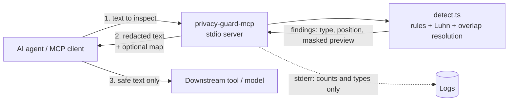

# Architecture

## Components

- **Transport:** MCP over stdio. No ports, no network.
- **Server (`src/server.ts`):** registers three tools, validates input with zod, converts errors to MCP `isError` results.
- **Core (`src/detect.ts`):** ordered rules with priorities; Luhn validation for cards; phone and date disambiguation; overlap resolution; custom patterns; size cap.

## Data handling

| Data | Where it goes |
| --- | --- |
| Input text | Memory only, for the duration of the call |
| Scan result | Types, offsets, masked previews |
| Redacted text | Returned to the caller |
| Reversible map | Returned to the caller only when `reversible=true`; never stored |
| Logs | stderr, entity counts only |

## Trust boundary

The server protects only what the caller routes through it. To enforce protection, put it (or a hosted equivalent) in the path that every outbound agent call must take.
